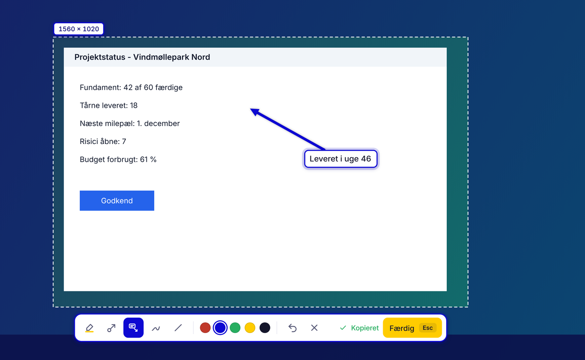

<p align="center"></p>

<h1 align="center">Klik</h1>

<p align="center"><b>Screenshots with fewer clicks.</b><br>
Only what you need, and it does that really well.</p>

<p align="center">
  <a href="https://github.com/HenningKristensenDK/klik/releases/latest/download/Klik-setup.exe"><b>⬇ Download for Windows</b></a>
  &nbsp;·&nbsp; free &nbsp;·&nbsp; open source (MIT)
</p>

<p align="center"></p>

## How it works

1. Press **Ctrl+Alt+K**, or right-click the Klik icon on the taskbar and choose **Take screenshot**. The screen freezes. A click on the icon opens Klik Studio.
2. **Drag** an area, or click once for the whole screen. It is already on your clipboard.
3. Mark it up if you like. Every marking updates the clipboard at once.
4. **Ctrl+V** wherever you are: Teams, Outlook, Word, a browser.

No save dialog, no copy button. **Esc** just closes. Images are also saved in `Pictures\Klik`.

## The tools

| Key | Tool |
|---|---|
| `M` | Highlighter (selected from the start) |
| `A` | Numbered arrow: 1, 2, 3 … Click without dragging for just the number |
| `K` | Arrow with a comment. Type, then Enter. Click without dragging for just the comment |
| `P` | Pen |
| `L` | Line |
| `Ctrl+Z` | Undo |
| Right-click | Select again |

Five colours. `Shift` while drawing gives a straight stroke.

## Klik Studio

Right-click the Klik icon by the clock and choose **Klik Studio**. Click your screenshots to turn them into a **4:5 LinkedIn carousel** or **16:9 slides**, with brand checks that keep text readable on a phone. Export gives a PDF plus one PNG per slide. Add your name, photo and logo once; they stay on your PC.

## Works with Claude

Klik comes with a small MCP server, so Claude can see your latest screenshot, pass work between Claude sessions through a local inbox, and draft a Studio carousel from your screenshots, with no copy-paste.
Download `Klik.mcpb` from the [latest release](https://github.com/HenningKristensenDK/klik/releases/latest) and double-click it to add it to Claude Desktop. More in [mcp/README.md](mcp/README.md).

## Privacy

Klik sends nothing anywhere. Screenshots stay on your PC. Claude only sees a screenshot when you ask it to, through the extension you installed.

## Install notes

- Windows 10 and 11. No admin rights needed.
- Windows may say "Windows protected your PC", because the installer isn't signed yet. Click **More info**, then **Run anyway**. A Microsoft Store version is on the way.
- If another program already uses `Ctrl+Alt+K`, Klik picks a free key. Right-click the Klik icon by the clock to see it.

## What's next

See the [roadmap](ROADMAP.md). Ideas and bugs: [open an issue](https://github.com/HenningKristensenDK/klik/issues).

## Build it yourself

Tauri 2, React and TypeScript for the editor, Rust for capture and the MCP server.

```
cd app && npm install && npm run dev     # the editor in a browser, with a demo desktop
cd mcp && cargo test                     # the MCP server
```

Windows builds run on GitHub Actions ([build.yml](.github/workflows/build.yml)). The product spec is in [docs/SPEC.md](docs/SPEC.md).

---

Made by Real Time Project Management · MIT licence
